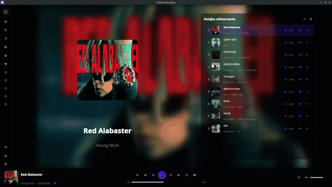
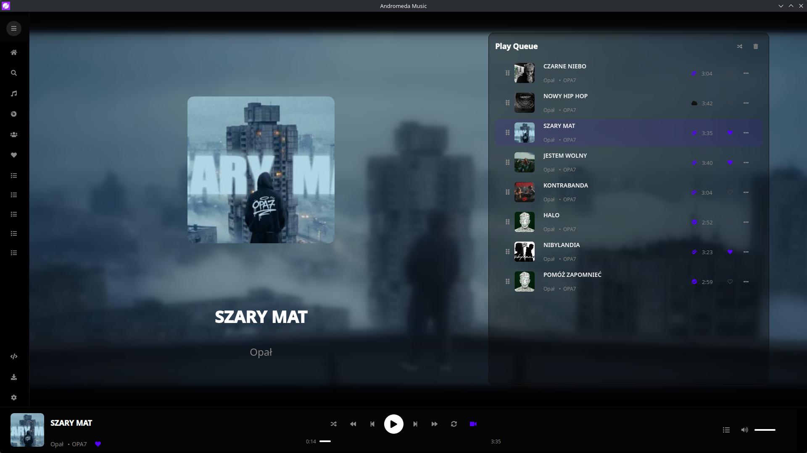
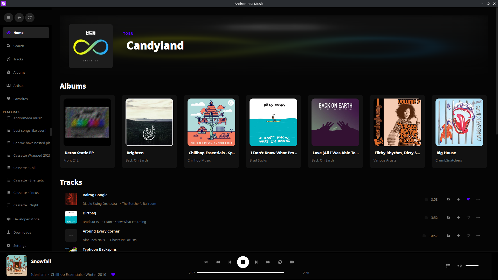
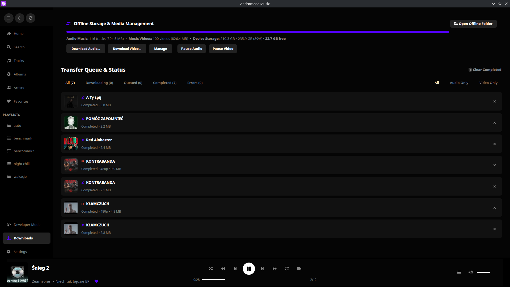
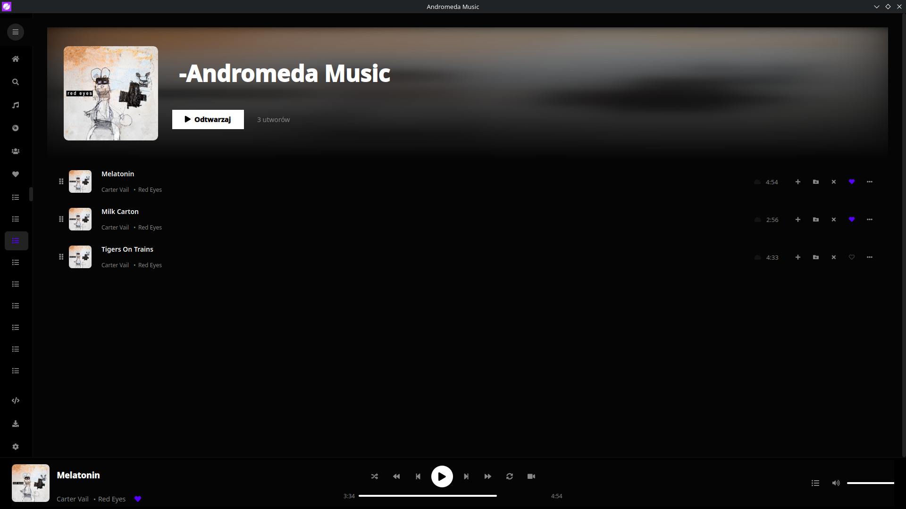
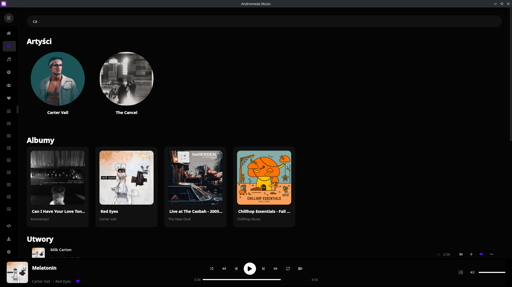

<div align="center">


# Andromeda Music
### *High-performance Linux music player & ambient video visualizer for Navidrome & YouTube*

[](https://github.com/batatudev/andromeda-music/actions/workflows/ci.yml)
[](https://github.com/batatudev/andromeda-music/releases)
[](LICENSE)
[](https://www.python.org/)
[](https://doc.qt.io/qtforpython-6/)
[-FCC624.svg?style=flat-square&logo=linux&logoColor=black)](https://www.kernel.org/)
[](https://pipewire.org/)

<br />



<p><em>Real-time hardware-accelerated GLSL kinetic video ambient blur (~2–3% CPU overhead)</em></p>

**100% Native (0% Electron)** &nbsp;&bull;&nbsp; **21,420 lines of code** &nbsp;&bull;&nbsp; **113 files** &nbsp;&bull;&nbsp; **190 commits** &nbsp;&bull;&nbsp; **6+ months of craftsmanship**

<p align="center">
  <a href="#quick-test-drive">Quick Test Drive</a> •
  <a href="#why-i-built-it--author-note">Why I Built It</a> •
  <a href="#benchmarks">Benchmarks</a> •
  <a href="#key-features">Key Features</a> •
  <a href="#user-interface">Screenshots</a> •
  <a href="#installation">Installation</a> •
  <a href="#community-testing">Community Testing</a> •
  <a href="#license">License</a>
</p>

</div>

---

> [!TIP]
> ### 🚀 Quick Test Drive (No Server Setup Required)
> Andromeda Music comes pre-configured with the public **Navidrome Demo Server** (`demo.navidrome.org`).  
> *(Note: As a shared public demo, music streaming may occasionally buffer slower than on a private LAN/VPS server).*
> 
> **Want to test live synchronized video ambient immediately without your own library?**  
> 1. Launch Andromeda Music and click the **`-Andromeda Music`** playlist in the sidebar.  
> 2. Or search for tracks by artist **Carter Vail**: ***Melatonin***, ***Milk Carton***, or ***Tigers On Trains***.  
> 3. Hit play and toggle the **Video** icon on the player bar — music videos are already pre-linked and ready to stream!

---

## Why I Built It & Author Note

> *"I created Andromeda Music because none of the existing Linux music players met my expectations. Available options were either sluggish Electron web-wrappers consuming gigabytes of RAM or bloated with cluttered, dated menus — and none offered unique visual immersion like a synchronized, ambient kinetic video backdrop.*
>
> *To be 100% transparent with the open-source community: this project was built through dedicated **AI-assisted engineering ('vibe-coding')**. However, it is not an automated prompt dump — it represents over half a year of relentless passion and hands-on craftsmanship. Every feature, architecture decision, state machine, and UI layout was conceptualized, designed, tested, and profiled on Linux kernel interfaces by me personally, utilizing AI as a high-velocity coding partner.*
>
> *What began as a curiosity turned into a production-grade desktop player with over 21,400 lines of modular code across 190 commits. I am proud to share it and give back to the Linux community."*
>
> — **batatudev**, Creator of Andromeda Music

---

## The Manifesto & Benchmarks

* **Say NO to Electron Bloat:** Web-wrapped desktop players easily consume 800 MB to 1.5 GB of RAM just to play audio. Andromeda Music is written natively in **Python 3 and PySide6 (Qt6)**. It utilizes direct GPU hardware shaders via **Qt RHI and QML MultiEffect**, sipping just **~120–240 MB of RAM** and launching in **<450 ms**.
* **Zero Walled Gardens (Self-Hosted Freedom):** Your music library lives on your own self-hosted **Navidrome / Subsonic** server. No streaming platform can revoke your favorite tracks.
* **Cinematic Video with True Audio-First Reliability:** Ambient music videos provide kinetic ambiance behind your tracks. Audio is sacred: network drops or video issues will **never interrupt or stall your music playback**.

<details id="benchmarks">
<summary><b>📊 Real-World Linux Benchmark: Andromeda vs Electron (Click to expand)</b></summary>
<br>

*Tested on Intel Core i5-8350U, UHD Graphics 620 on Fedora / KDE Plasma / Wayland (Kernel measurement via `/proc/smaps_rollup` & DRM fdinfo):*

| Metric / Scenario | 🥇 Andromeda Music | Spotify (Electron) | Feishin (Electron) | Brave Browser |
| :--- | :---: | :---: | :---: | :---: |
| **Idle Memory (PSS / RSS)** | **233 MB** / 359 MB | 922 MB / 1561 MB | 455 MB / 888 MB | 505 MB / 1569 MB |
| **Audio Playback CPU** | **1.15%** (9% of 1 core) | 4.64% (37% of 1 core) | 2.19% (17% of 1 core) | 1.51% (12% of 1 core) |
| **Video Ambient Composition** | **Zero-Copy GPU (GLSL)** | N/A | N/A | Software Canvas |
| **Active System Processes** | **1 single process** | 11 processes | 14 processes | 14 processes |

> **Key takeaway:** While Electron wrappers wake up CPUs continuously and spawn dozens of helper processes, Andromeda executes in a single native process with negligible background CPU footprint.

</details>

---

## Key Features

### 1. ⚡ Native Lightweight Performance (Zero Electron)
* **Spotify Dark Ergonomics:** Clean, distraction-free interface engineered for usability and visual harmony.
* **Tiling Window Manager Ready:** Built with flexible, non-breaking card containers (`ResponsiveCardRow`) with zero rigid width locks. Scales effortlessly from full-screen 4K desktops down to narrow split-views in **Hyprland, Sway, i3, KDE Plasma, and GNOME**.
* **Fractional Scaling on Wayland:** Crisp vector iconography (QtAwesome) and high-DPI cover art rendering at 125%, 150%, 175%, and 200% scale factors.

### 2. 🎵 Hi-Fi Lossless Audio & Offline-First Browsing
* **Direct Stream Playback:** Native bitstream playback of **FLAC, ALAC, Opus, AAC, OGG, and MP3** files directly from your server without lossy server-side transcoding.
* **Instant SQLite WAL Cache:** Library browsing is backed by a local SQLite database running in Write-Ahead Logging (WAL) mode. If your server goes down or your Wi-Fi drops, Andromeda switches to **Offline-First fallback** instantly without throwing errors.
* **Multi-Server Partitioning:** Connect to multiple Navidrome servers with fully isolated caches, offline databases, and custom artwork per profile.

### 3. 🎬 Cinematic Video Ambient (GPU Zero-Copy)
* **One-Click Video Switcher:** Seamlessly toggle between album cover art and live synchronized YouTube music videos.
* **Hardware-Accelerated GLSL Blur:** Ambient live video blurring runs entirely on your GPU shaders via QML `MultiEffect`. It consumes only **2–3% CPU** (compared to software blur filters that saturate modern CPUs at 100%).
* **Auto-Resolution-Fallback (ARF 3.1):** An adaptive watchdog continuously monitors buffer health. During network throttling, it gracefully steps down video resolution (`1080p` $\to$ `720p` $\to$ `480p` $\to$ pure audio mode) to guarantee uninterrupted music.
* **Sub-Second PURL Range Sniffing:** Extracts YouTube video links from audio file ID3 tags using partial 256 KB HTTP Range requests without downloading entire audio files.

### 4. 💾 Zenith-Style Offline Storage & Download Center
* **Complete Offline Storage Control:** No hidden black-box caches. You have full visibility over downloaded music and video files.
* **Physical NVMe Storage Meter:** Real-time visual disk bar showing exact space consumed by audio, videos, and remaining storage on your drive.
* **One-Click Bulk Downloads:** Download entire playlists, full albums, artist discographies, or liked songs in one click — available as raw audio or 1080p video files.
* **Smart Background Queue:** Features multi-state filtering (Downloading, Queued, Completed, Errors), temporary file (`.part`) sanitization, and automatic rate-limit circuit breakers.

### 5. 🐧 True Linux Desktop Citizen
* **Native MPRIS2 D-Bus:** Full playback control, volume synchronization, track metadata, and cover art displayed in KDE Plasma audio applets, GNOME Media Controls, Waybar, Polybar, and `playerctl`.
* **Dynamic PipeWire / PulseAudio Routing:** Properly sets stream role (`media.role="music"`) and gracefully handles on-the-fly output device switching (Bluetooth headphones, USB DACs, speakers).
* **Strict XDG Standard Compliance:** Completely clean home directory. All files reside in standard directories: `$XDG_CONFIG_HOME`, `$XDG_DATA_HOME`, and `$XDG_CACHE_HOME`.

---

## User Interface

<div align="center">
  
  <p><em>Cinematic playback view with hardware-accelerated ambient video blur</em></p>
</div>

<div align="center">
  
  
</div>

<div align="center">
  
  
  <p><em>From left to right: Home Grid, Offline Transfer Center, Playlist Details, and Instant Search</em></p>
</div>

---

## Command Line Interface (CLI Flags)

Andromeda Music includes convenient flags for terminal launchers, keybind scripts, and diagnostic reporting:

```bash
# Print sanitized system, audio, graphics, and server diagnostics for bug reporting:
andromeda-music --diagnostics

# Automatically play a specific playlist on startup:
andromeda-music --play-playlist "Synthwave"

# Force startup directly in music video mode:
andromeda-music --video
```

---

## Installation

### Method 1: Universal Linux Installer (Recommended)

Clone the repository and run the automated installer script. It sets up an isolated Python virtual environment with system D-Bus bindings and registers desktop launchers:

```bash
# 1. Clone the repository
git clone https://github.com/batatudev/andromeda-music.git
cd andromeda-music

# 2. Run the Linux installation script
./install.sh
```

Launch Andromeda Music from your application launcher (KDE / GNOME / Rofi) or via terminal:
```bash
andromeda-music
```

### Method 2: Manual Development Setup

```bash
# Create virtual environment with system site-packages (required for D-Bus / MPRIS)
python3 -m venv --system-site-packages .venv
source .venv/bin/activate

# Install dependencies
pip install --upgrade pip
pip install -r requirements.txt

# Run the automated integrity test suite
python3 tests/test_integrity.py

# Run the application
python3 main.py
```

### Method 3: Flatpak (Flathub)
> *Flatpak package manifest (`io.github.batatudev.AndromedaMusic`) is currently being prepared for official Flathub submission.*

---

> [!NOTE]
> ### 🐧 Community Testing & First Release Disclaimer
> While hundreds of hours have been invested into fine-tuning Andromeda on modern Linux desktops, the Linux ecosystem is extraordinarily vast and diverse — encompassing hundreds of distributions, Wayland vs. X11 display servers, dynamic tiling window managers (Hyprland, Sway), and distinct GPU drivers (Intel VA-API, AMD RADV, Nvidia GBM).
> 
> As an independent solo developer, it is physically impossible to test every single hardware and distro combination alone. This is Andromeda's first public Release Candidate (`v1.0.0-rc1`).
> 
> If you encounter any bugs, crashes, or visual glitches, please report them via [GitHub Issues](https://github.com/batatudev/andromeda-music/issues)! To help me diagnose issues quickly, simply attach the output of:
> ```bash
> andromeda-music --diagnostics
> ```

---

## System Requirements

| Component | Minimum | Recommended |
| :--- | :--- | :--- |
| **Operating System** | Linux (Kernel 5.15+, glibc 2.35+) | Fedora 40+, Arch Linux, Ubuntu 24.04+, openSUSE |
| **Display Server** | X11 or Wayland | Wayland (KDE Plasma 6, GNOME 46+, Hyprland) |
| **Python** | 3.10 | 3.11 or 3.12 |
| **Audio Server** | PulseAudio | PipeWire with WirePlumber |
| **External Utilities** | `ffmpeg` | `ffmpeg` 6.0+ |
| **GPU Acceleration** | OpenGL 3.3 / Mesa Drivers | Intel (VA-API), AMD (RADV), Nvidia (GBM) |

---

## Configuration & Data Paths

All configuration is managed through the in-app **Settings** view and stored in strict compliance with the XDG Base Directory specification:
* **Configuration:** `~/.config/andromeda-music/config.ini`
* **Data & Downloads:** `~/.local/share/andromeda-music/`
* **Caches & Databases:** `~/.cache/andromeda-music/`

### YouTube Anti-Bot & Cookies Configuration
If your IP address encounters YouTube rate-limiting (HTTP 429), place an exported Netscape `cookies.txt` file into your data directory to bypass verification:
```bash
cp /path/to/exported/cookies.txt ~/.local/share/andromeda-music/cookies.txt
```
Andromeda will automatically detect and prioritize this file for all streaming and download operations.

---

## License

This project is licensed under the **GNU General Public License v3.0 or later (GPL-3.0-or-later)**.  
See the [LICENSE](LICENSE) file for the full license text.

Copyright (C) 2026 **batatudev** and Andromeda Music Authors.
```